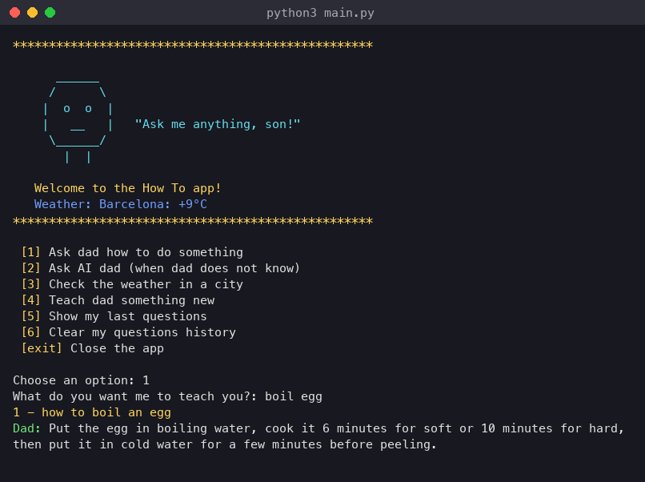
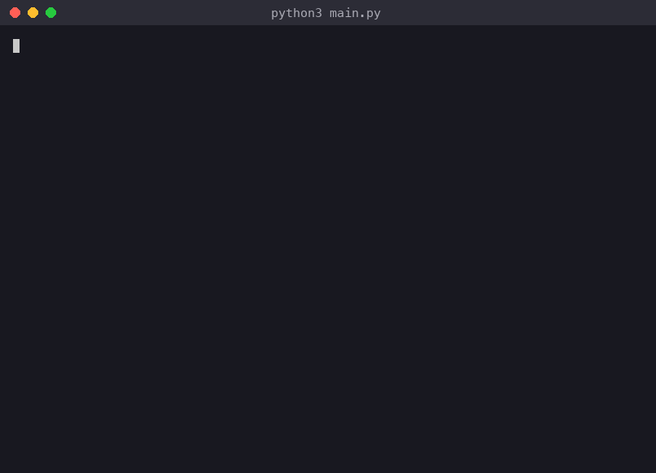

# How To? 👨


## Description
- **What problem it solves:** your dad knows a lot, but you never ask him to teach you. This app is your dad in the console: ask him how to do something and he tells you, step by step.
- **Main features:**
  - Ask dad a "how to" question and get the 3 best answers
  - Ask AI dad (Claude AI) when dad does not know the answer
  - See today's weather on the main screen and check the weather in any city
  - Teach dad something new (it is saved in his memory file)
  - See and clear your last questions (saved in a SQLite database)
  - Colored menu, dad picture and slow "typing" text
- **Who it's for:** anyone who wants quick simple instructions for everyday things (phones, computers, cooking, studying...)

## Screenshots



## Installation

```bash
git clone https://github.com/OmarMudhaffar/how_to.git
cd how_to
python3 -m venv .venv
source .venv/bin/activate
pip install -r requirements.txt
cp .env.example .env        # then put your values in .env
python3 main.py
```

`.env` values:
- `ANTHROPIC_API_KEY` - your Claude API key (only needed for "Ask AI dad")
- `CITY` - the city for the weather on the main screen

Run the tests:

```bash
python3 -m pytest
```

## Usage



1. Run the app with `python3 main.py`
2. Choose a number from the menu
3. Ask your dad to teach you something
4. Learn it
5. Thank your dad
6. Type `exit` to close the app

## TODO

### Incomplete Planned Features
- [x] Record a gif of the app and add it to `images/demo.gif`
- [x] Add a screenshot to `images/screenshot1.png`
- [ ] Deploy the app online so people outside the course can use it

## Project Structure
```
how_to/
├── .gitignore              # Files to ignore in Git
├── .env.example            # Example of the secrets file
├── README.md               # Project description
├── requirements.txt        # Python dependencies
├── main.py                 # Main entry point
├── dad-head/
│   └── howto.txt           # Everything dad knows
├── lib/                    # Source code folder
│   ├── program.py          # Menu loop and menu actions
│   ├── menuside.py         # Banner and menu printing
│   ├── people.py           # Person and Dad classes
│   ├── how_to.py           # Search and regex checks
│   ├── data.py             # Read / write the howto.txt file
│   ├── history.py          # SQLite questions history
│   ├── weather.py          # Weather API
│   ├── ai.py               # Claude AI
│   ├── logger.py           # Logging + decorator
│   └── colors.py           # Colors and slow typing
└── tests/
    └── test_main_functions.py
```

## Acknowledgments

- [wttr.in](https://wttr.in) for the free weather API
- [Anthropic Claude](https://docs.claude.com) for the AI answers

## Team Members
- GitHub: [@OmarMudhaffar](https://github.com/OmarMudhaffar)

## Support

☕ **Buy Me a Coffee:** ask your dad
